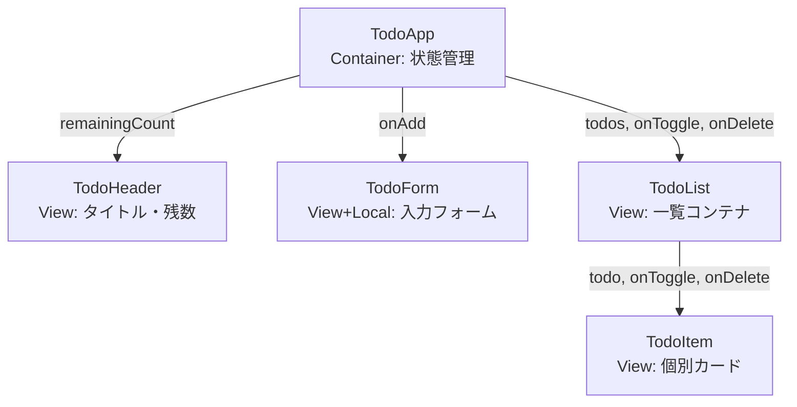
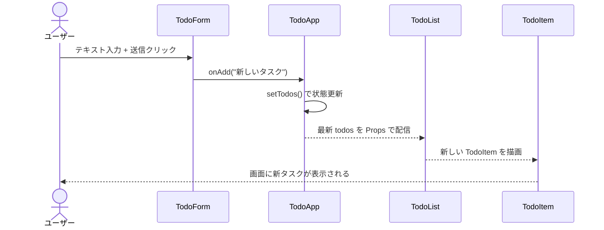

# TODO管理アプリ コンポーネント基本設計書

## 1. 概要

本ドキュメントは、React で構築する TODO管理アプリのコンポーネント構成、状態（State）の配置場所、およびコンポーネント間のデータ・イベント連携フローを定義する基本設計書である。

---

## 2. コンポーネント階層図 (Component Hierarchy)

### 階層構造

- **TodoApp** (Container: 全体の状態管理・ロジック)
  ├── **TodoHeader** (View: タイトル・残タスク数表示)
  ├── **TodoForm** (View + ローカルState: 新規TODO入力フォーム)
  └── **TodoList** (View: TODO一覧表示コンテナ)
  └── **TodoItem** (View: 個々のTODOカード・操作ボタン)

### Mermaid による構造図



---

## 3. コンポーネントの役割定義

| コンポーネント名 | 種別         | 役割・責務                                                                           |
| :--------------- | :----------- | :----------------------------------------------------------------------------------- |
| **TodoApp**      | Container    | アプリ全体の `todos` 状態を保持し、追加・完了切替・削除ロジックを一元管理する。        |
| **TodoHeader**   | View         | アプリタイトルと、親から受け取った残タスク数 `remainingCount` を表示する（計算は `TodoApp` が `todos.filter(t => !t.completed).length` で行う）。 |
| **TodoForm**     | View + Local | 入力中テキストをローカル state で管理。送信時に親の `onAdd` を呼び出す。           |
| **TodoList**     | View         | 親から受け取った `todos` 配列を `.map()` で `TodoItem` に展開して描画する。    |
| **TodoItem**     | View         | 1件のTODOデータを表示。チェックボックスと削除ボタンの操作を親に通知する。            |

---

## 4. 状態管理設計 (State Location)

### 保持する状態

- **状態名**: `todos`
- **型**: `Todo[]`（`{ id: string; text: string; completed: boolean }`）
- **配置場所**: `TodoApp` コンポーネント

### 配置理由 (Lifting State Up)

`TodoForm`（追加）、`TodoList`（表示）、`TodoHeader`（カウント）の3コンポーネントが `todos` を参照する。
これら全ての共通の親は `TodoApp` であるため、React の単方向データフロー原則に従い `TodoApp` に状態を配置する。

### Props vs Context 判定

バケツリレーは最大2階層（App → List → Item）のため、Context は不要。Props で十分に管理可能。

---

## 5. イベントフロー設計

### タスク追加フロー

1. ユーザーが TodoForm にテキスト入力し送信ボタンをクリック
2. TodoForm が `onAdd(inputText)` を実行（Props 経由で親を呼び出し）
3. TodoApp が `setTodos([...todos, { id, text, completed: false }])` で状態更新
4. React が再描画し、TodoList に新しい TodoItem が出現

### タスク完了切替フロー

1. ユーザーが TodoItem のチェックボックスをクリック
2. TodoItem が引数なしの `onToggle()` を実行
3. TodoList が `onToggle={() => onToggle(todo.id)}` として `id` を束ねて渡しているため、TodoApp の `handleToggle(id)` が呼ばれる
4. `setTodos(prev => prev.map(t => t.id === id ? {...t, completed: !t.completed} : t))`

### タスク削除フロー

1. ユーザーが TodoItem の削除ボタンをクリック
2. TodoItem が引数なしの `onDelete()` を実行
3. TodoList が `onDelete={() => onDelete(todo.id)}` として `id` を束ねて渡しているため、TodoApp の `handleDelete(id)` が呼ばれる
4. `setTodos(prev => prev.filter(t => t.id !== id))`

---

## 6. Props 型定義

```tsx
interface Todo {
  id: string;
  text: string;
  completed: boolean;
}

interface TodoHeaderProps {
  remainingCount: number;
}

interface TodoFormProps {
  onAdd: (text: string) => void;
}

interface TodoListProps {
  todos: Todo[];
  onToggle: (id: string) => void;
  onDelete: (id: string) => void;
}

interface TodoItemProps {
  todo: Todo;
  onToggle: () => void;
  onDelete: () => void;
}
```

---

## 7. シーケンス図（タスク追加）


